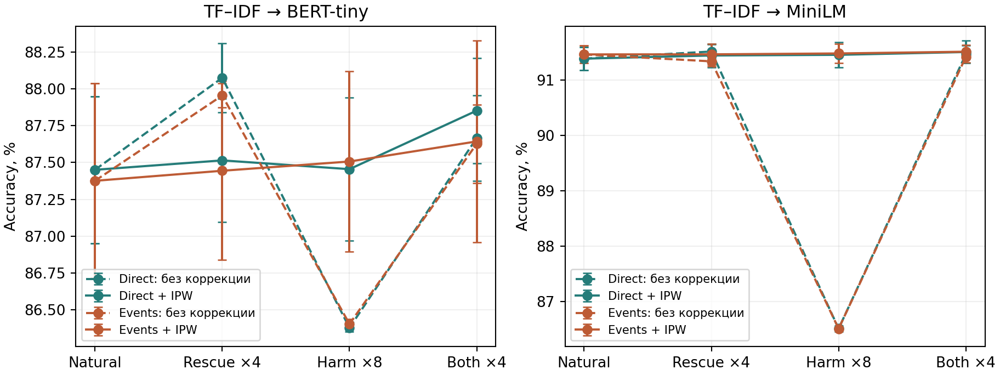

# Выбор политики маршрутизации в двухмодельных каскадах: влияние данных, структуры ошибок и вычислительного бюджета

**Автор:** Anastasia Shlopak

**Научный руководитель:** Archil Maysuradze, PhD

**Аннотация**

Каскад из двух фиксированных классификаторов экономит вызовы второй модели, если маршрутизатор различает полезные и вредные замены ответа. Цель работы — установить, как объём и состав парной разметки влияют на выбор способа обучения такого маршрутизатора. Сравниваются прямая регрессия прироста качества, оценивание вероятностей исправления и ухудшения ответа, ошибка первой модели и её неуверенность. Предложен контролируемый протокол: фиксируются эксперты и признаки, изменяются распределение обучающих извлечений и коррекция их весов, а выбор метода отделяется от настройки его параметров. На двух парах классификаторов BANKING77 проведены 30 повторений при трёх объёмах обучения и трёх квотах эскалации. При обогащении вредными заменами коррекция восстанавливает качество: для второй модели MiniLM выигрыш над обучением без коррекции составляет около 4,95 процентного пункта при квоте 20%; для BERT-tiny — около 1,1. Различия сохраняются после общей поправки на запланированные сравнения. Выбор метода по отдельной валидационной выборке не достигает качества лучшего доступного кандидата в среднем: потеря составляет 0,34–0,36 процентного пункта при 1000 обучающих извлечениях. Результаты показывают необходимость отделять изменение целевой величины при отборе от преимуществ параметризации роутера. Исследование ограничено фиксированными экспертами и ранее изученным тестом одного датасета; перенос рекомендаций на новые задачи остаётся отдельной целью.

## Текст

- [Аннотация](paper/paper_sections/аннотация.md)
- [Введение](paper/paper_sections/введение.md)
- [Обзор литературы — Related works](paper/paper_sections/related_works.md)
- [Постановка задачи](paper/paper_sections/постановка%20задачи.md)
- [Метод и теоретические основания](paper/paper_sections/method.md)
- [Вычислительные эксперименты](paper/paper_sections/вычислительные%20эксперименты.md)
- [Заключение](paper/paper_sections/conclusion.md)
- **[Статья — PDF](paper/main.pdf)**
- [Исходник LaTeX](paper/main.tex)

## Литература и иллюстрации

- [Обзор литературы](LINKREVIEW.md)
- [Библиография BibTeX](paper/references.bib)
- [Профили решений](paper/figures/decision_profiles.pdf)
- [Кривая ошибки](paper/figures/error_curve.pdf)
- [Презентация — 10 слайдов и резерв](slides/main.pdf)
- [Однослайдовая версия](slides/one_slide.pdf)
- [Текст доклада, тайминг и ответы на вопросы](slides/README.md)

## Основной результат



При **одинаковых harm-rich примерах** взвешивание восстанавливает уровень natural-обучения у Direct и Events. Выигрыш около 4,95 п.п. для MiniLM относится к сравнению **с невзвешенным harm-rich**, а не с natural. Все четыре harm-контраста поддержаны общей поправкой на 14 сравнений; для других обогащений такого вывода нет.

Отдельный selector-dev из 500 примеров позволяет оценить сам выбор метода: средняя потеря относительно лучшего test-кандидата — 0,34–0,36 п.п. [Полная таблица контрастов](paper/generated/followup_contrasts.csv) и [протокол проверки](code/PROTOCOL_FOLLOWUP.md).

## Воспроизведение

```bash
python3 -m venv .venv
.venv/bin/python -m pip install -r code/requirements.txt
.venv/bin/python code/run.py
```

Запуск повторно обучает роутеры по фиксированному кэшу экспертов и проверяет 1440 строк метрик. Построение графиков отделено от обучения. [Данные, конфигурация и команды сборки документов](code/README.md).

Дополнительный контроль состава и выбора метода:

```bash
.venv/bin/python code/followup.py
.venv/bin/python code/analyze_followup.py
.venv/bin/python code/build_documents.py
```

Обучаются 2700 роутеров; выполняются аудит сохранённых прогнозов, 2000 bootstrap повторов и построение таблиц/графиков. [Полные численные метрики](paper/generated/followup_metrics.csv.gz), [сводки](paper/generated/followup_summary.csv), [проверки и хеши](paper/generated/followup_manifest.json). Исходный baseline и новый контроль сохраняются отдельно.

## Лицензия

Код: [MIT](LICENSE). Данные BANKING77 и производный кэш: [CC BY 4.0](code/data/BANKING77_LICENSE), источник — [PolyAI](https://github.com/PolyAI-LDN/task-specific-datasets), [Casanueva et al., 2020](https://aclanthology.org/2020.nlp4convai-1.5/).
