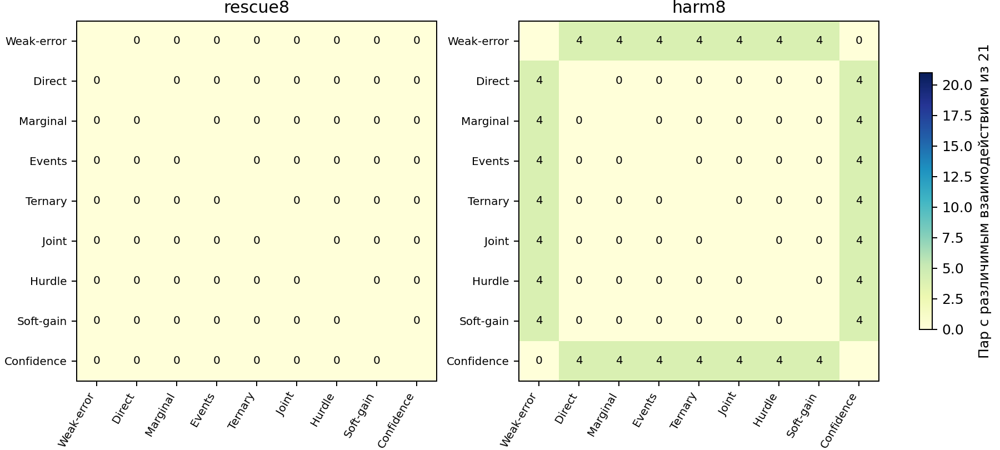
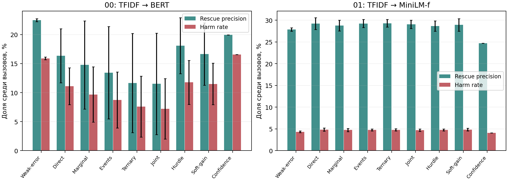
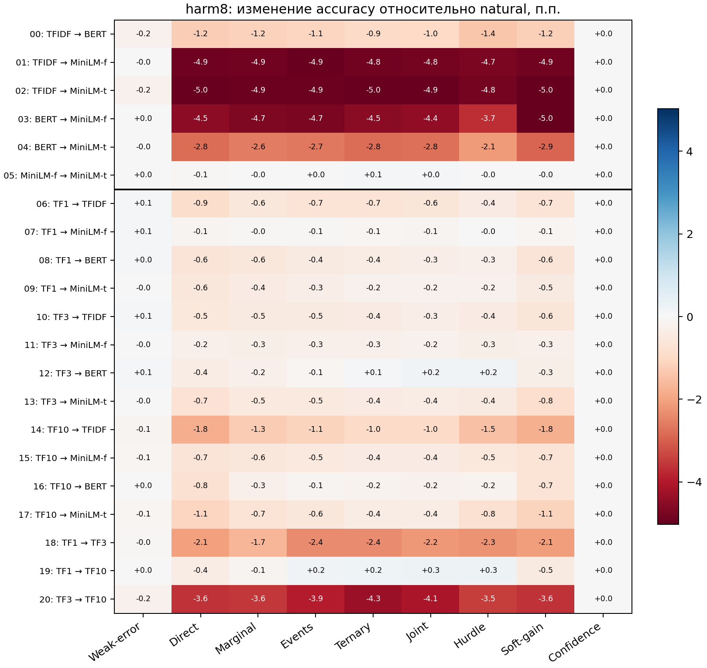
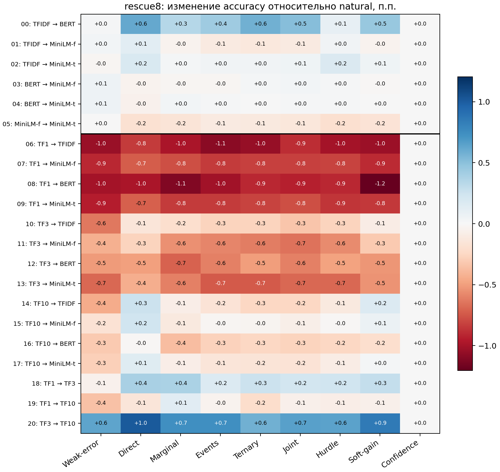
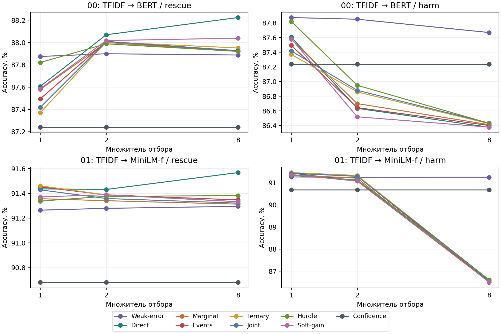
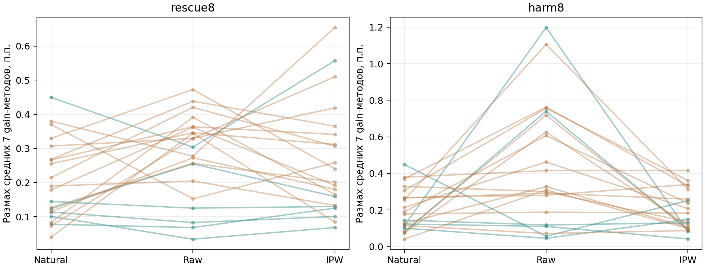

# Выбор маршрутизатора при дисбалансе парных исходов

Главный вопрос: меняет ли состав обучения относительное качество разных способов обучения роутера? Коррекция отбора — дополнительный контроль механизма, а не замена этой задачи.

## Что проверено

Все 8 обучаемых методов (7 gain-оценивателей и weak-error), confidence и random; все 21 прежняя пара семи фиксированных экспертов. 3 размера fit, 7 составов, 4 дополнительных IPW-варианта, 20 seeds, 3 квоты, official/clean test. Обучены 110880 выбранных роутеров после 443520 candidate fits. Пулы, эксперты и тест уже использовались раньше; это exploratory контроль, не независимая репликация.

[Протокол до запуска](../../code/PROTOCOL_IMBALANCE.md). [Состав 21 пары](pairs.csv). Основная статистическая область: fit1000, квота20%, official test3080. 2000 crossed paired bootstrap, exact top-k; одна общая max-t поправка на 5691 контраст.

## Результаты всей статистической семьи

| kind        |   total |   significant |   gain_total |   gain_significant |
|:------------|--------:|--------------:|-------------:|-------------------:|
| correction  |     336 |            34 |          294 |                 34 |
| interaction |    1512 |            56 |          882 |                  0 |
| profile     |    1512 |             0 |          882 |                  0 |
| selector    |      63 |             0 |            0 |                  0 |
| simple      |    2268 |            77 |         1323 |                  4 |

`simple` — попарная accuracy в natural/rescue8/harm8; `interaction` — изменение попарной разности относительно natural; `profile` — rescue precision/harm rate в natural; `correction` — IPW−raw; `selector` — dev-выбор−confidence. `gain_*` исключает weak-error и confidence. Количества относятся к зависимым конфигурациям одного датасета.

Попарные accuracy-сравнения по составам:

| arm         |   total |   significant |   gain_total |   gain_significant |
|:------------|--------:|--------------:|-------------:|-------------------:|
| harm8_raw   |     756 |            77 |          441 |                  4 |
| natural_raw |     756 |             0 |          441 |                  0 |
| rescue8_raw |     756 |             0 |          441 |                  0 |

Различимые взаимодействия обнаружены в 4 из 21 пары; между семью gain-методами — в 0. Поддержанная смена знака преимущества (оба простых одновременных интервала по разные стороны нуля): 0, из них gain-only 0.

## Близкая accuracy и разные профили решений

В 0 сравнениях natural различим хотя бы один компонент профиля, тогда как accuracy-контраст не обнаружен; среди gain-only — 0. Отсутствие значимости accuracy не доказывает её равенства или эквивалентности.

Precision спасений — доля спасений среди эскалаций; recall — доля найденных спасений среди всех доступных. При фиксированной квоте эти показатели зависят от одного числа спасений и не являются независимыми подтверждениями. Accuracy определяется спасениями за вычетом вреда. Поэтому анализируется и harm rate.

|   pair | method     |   accuracy_pct |   rescue_precision_pct |   rescue_recall_pct |   harm_rate_pct |
|-------:|:-----------|---------------:|-----------------------:|--------------------:|----------------:|
|      0 | weak_error |        87.875  |                22.4838 |             75.6831 |         15.901  |
|      0 | direct     |        87.6071 |                16.3393 |             55      |         11.0958 |
|      0 | marginal   |        87.5795 |                14.7727 |             49.7268 |          9.6672 |
|      0 | events     |        87.4951 |                13.4334 |             45.2186 |          8.75   |
|      0 | ternary    |        87.3718 |                11.6558 |             39.235  |          7.5893 |
|      0 | joint      |        87.4188 |                11.5179 |             38.7705 |          7.2159 |
|      0 | hurdle     |        87.8214 |                18.0844 |             60.8743 |         11.7695 |
|      0 | soft_gain  |        87.586  |                16.6396 |             56.0109 |         11.5016 |
|      0 | confidence |        87.2403 |                19.9675 |             67.2131 |         16.5584 |
|      1 | weak_error |        91.2646 |                27.8571 |             70.0408 |          4.3263 |
|      1 | direct     |        91.4367 |                29.2289 |             73.4898 |          4.8377 |
|      1 | marginal   |        91.3571 |                28.7419 |             72.2653 |          4.7484 |
|      1 | events     |        91.4529 |                29.2289 |             73.4898 |          4.7565 |
|      1 | ternary    |        91.461  |                29.2938 |             73.6531 |          4.7808 |
|      1 | joint      |        91.4286 |                29.0584 |             73.0612 |          4.7078 |
|      1 | hurdle     |        91.3377 |                28.6526 |             72.0408 |          4.7565 |
|      1 | soft_gain  |        91.3718 |                28.9123 |             72.6939 |          4.8458 |
|      1 | confidence |        90.6818 |                24.6753 |             62.0408 |          4.0584 |
|      5 | weak_error |        92.1494 |                12.8084 |             96.2195 |         13.5877 |
|      5 | direct     |        92.3734 |                 9.1721 |             68.9024 |          8.8312 |
|      5 | marginal   |        92.3101 |                 9.9675 |             74.878  |          9.9432 |
|      5 | events     |        92.2727 |                 9.862  |             74.0854 |         10.0244 |
|      5 | ternary    |        92.2808 |                 9.8458 |             73.9634 |          9.9675 |
|      5 | joint      |        92.2873 |                 9.7159 |             72.9878 |          9.8052 |
|      5 | hurdle     |        92.3588 |                10.0893 |             75.7927 |          9.8214 |
|      5 | soft_gain  |        92.3328 |                 9.8864 |             74.2683 |          9.7484 |
|      5 | confidence |        92.1753 |                12.8247 |             96.3415 |         13.474  |
|      7 | weak_error |        42.7094 |                81.3718 |             24.4632 |          0.4545 |
|      7 | direct     |        42.7208 |                81.4123 |             24.4754 |          0.4383 |
|      7 | marginal   |        42.6055 |                80.8523 |             24.307  |          0.4545 |
|      7 | events     |        42.6282 |                80.9497 |             24.3363 |          0.4383 |
|      7 | ternary    |        42.6591 |                81.1364 |             24.3924 |          0.4708 |
|      7 | joint      |        42.6916 |                81.2744 |             24.4339 |          0.4464 |
|      7 | hurdle     |        42.6169 |                80.9172 |             24.3265 |          0.4627 |
|      7 | soft_gain  |        42.6201 |                80.9253 |             24.3289 |          0.4545 |
|      7 | confidence |        42.2727 |                79.2208 |             23.8165 |          0.487  |

Полные интервалы профилей всех пар/методов: [natural_profiles.csv](natural_profiles.csv). Четыре приведённые пары: два исходных примера, две близкие MiniLM и low-label TF1→MiniLM-f; это иллюстрации, а не независимые задачи.

## Что меняется при дисбалансе

Ячейки показывают изменение среднего одного метода от natural, а не самостоятельные тесты его превосходства. Проверка неодинакового влияния на методы — контрасты `interaction`.

Средняя accuracy при множителях 1/2/8 для двух исходных пар. Полные SD, размеры 200/500/1000 и квоты 10/20/40% доступны в численных результатах.

### Улучшение или ухудшение относительно natural

Confidence не зависит от состава обучения, поэтому interaction каждого метода с confidence в точности равен его изменению accuracy от natural. Ниже число улучшений/ухудшений с той же общей поправкой, из 21 пары для каждой строки. Это позволяет отделить полезную обработку данных от ухудшения чувствительного метода.

|                               |   improvement |   degradation |
|:------------------------------|--------------:|--------------:|
| ('harm8_raw', 'direct')       |             0 |             4 |
| ('harm8_raw', 'events')       |             0 |             4 |
| ('harm8_raw', 'hurdle')       |             0 |             4 |
| ('harm8_raw', 'joint')        |             0 |             4 |
| ('harm8_raw', 'marginal')     |             0 |             4 |
| ('harm8_raw', 'soft_gain')    |             0 |             4 |
| ('harm8_raw', 'ternary')      |             0 |             4 |
| ('harm8_raw', 'weak_error')   |             0 |             0 |
| ('rescue8_raw', 'direct')     |             0 |             0 |
| ('rescue8_raw', 'events')     |             0 |             0 |
| ('rescue8_raw', 'hurdle')     |             0 |             0 |
| ('rescue8_raw', 'joint')      |             0 |             0 |
| ('rescue8_raw', 'marginal')   |             0 |             0 |
| ('rescue8_raw', 'soft_gain')  |             0 |             0 |
| ('rescue8_raw', 'ternary')    |             0 |             0 |
| ('rescue8_raw', 'weak_error') |             0 |             0 |

### Наибольшие взаимодействия между gain-методами

Ниже приводятся до 12 различимых контрастов, отсортированных после анализа по абсолютному эффекту, если такие обнаружены. Применяется одна общая поправка; полный список опубликован независимо от значимости.

Статистически различимых случаев в заданной семье не обнаружено.

### Простые различия между gain-методами в обогащённых режимах

|   pair_id | arm       | method   | reference   |   difference_pp |     low |    high |   adjusted_p |
|----------:|:----------|:---------|:------------|----------------:|--------:|--------:|-------------:|
|        14 | harm8_raw | direct   | ternary     |         -1.0584 | -2.1    | -0.0169 |       0.047  |
|        14 | harm8_raw | events   | soft_gain   |          0.9334 |  0.0809 |  1.786  |       0.0205 |
|        14 | harm8_raw | ternary  | soft_gain   |          1.1055 |  0.0823 |  2.1287 |       0.0255 |
|        14 | harm8_raw | joint    | soft_gain   |          1.0633 |  0.0316 |  2.095  |       0.0425 |

Значимость разности в одном режиме не равна значимости её изменения относительно natural. Поэтому эти строки не подменяют тест взаимодействия. Пара 14 — TF10→полный TFIDF; её включение в обсуждение обусловлено результатом полной семьи, а не новым подбором тестов.

### Поддержанные смены предпочтительности

Статистически различимых случаев в заданной семье не обнаружено.

Различимое взаимодействие может менять величину преимущества без смены победителя. Простая смена порядка средних также не равна статистически поддержанной смене предпочтительности.

## Коррекция и выбор метода

Медиана размаха средних семи gain-методов по 21 зависимой паре (п.п.; описательная сводка):

| arm             |   median |    min |    max |
|:----------------|---------:|-------:|-------:|
| discordant8_ipw |   0.1883 | 0.0747 | 0.5065 |
| discordant8_raw |   0.2744 | 0.0666 | 0.388  |
| harm2_raw       |   0.2094 | 0.0617 | 0.5292 |
| harm8_ipw       |   0.1494 | 0.0422 | 0.4156 |
| harm8_raw       |   0.3279 | 0.0455 | 1.1981 |
| natural_raw     |   0.1786 | 0.0406 | 0.4497 |
| neutral8_ipw    |   0.2386 | 0.0308 | 0.6299 |
| neutral8_raw    |   0.3279 | 0.0877 | 1.0666 |
| rescue2_raw     |   0.1705 | 0.0682 | 0.4351 |
| rescue8_ipw     |   0.2013 | 0.0682 | 0.6542 |
| rescue8_raw     |   0.3036 | 0.0341 | 0.4724 |

|   pair | method     |   natural_raw |   rescue8_raw |   harm8_raw |   rescue8_ipw |   harm8_ipw |
|-------:|:-----------|--------------:|--------------:|------------:|--------------:|------------:|
|      0 | weak_error |       87.875  |       87.888  |     87.6705 |       87.7646 |     87.7614 |
|      0 | direct     |       87.6071 |       88.224  |     86.3766 |       87.7857 |     87.5195 |
|      0 | marginal   |       87.5795 |       87.9205 |     86.4123 |       87.3506 |     87.5097 |
|      0 | events     |       87.4951 |       87.9253 |     86.401  |       87.3653 |     87.5    |
|      0 | ternary    |       87.3718 |       87.9513 |     86.4269 |       87.5568 |     87.5731 |
|      0 | joint      |       87.4188 |       87.9269 |     86.4334 |       87.4481 |     87.6185 |
|      0 | hurdle     |       87.8214 |       87.9205 |     86.4302 |       87.9075 |     87.7516 |
|      0 | soft_gain  |       87.586  |       88.039  |     86.3782 |       87.7468 |     87.5162 |
|      0 | confidence |       87.2403 |       87.2403 |     87.2403 |       87.2403 |     87.2403 |
|      1 | weak_error |       91.2646 |       91.2955 |     91.2516 |       91.1055 |     91.2532 |
|      1 | direct     |       91.4367 |       91.5682 |     86.5552 |       91.539  |     91.4854 |
|      1 | marginal   |       91.3571 |       91.3133 |     86.5016 |       91.4123 |     91.5081 |
|      1 | events     |       91.4529 |       91.3474 |     86.5032 |       91.5195 |     91.5211 |
|      1 | ternary    |       91.461  |       91.3328 |     86.612  |       91.5714 |     91.5276 |
|      1 | joint      |       91.4286 |       91.3214 |     86.612  |       91.4886 |     91.5    |
|      1 | hurdle     |       91.3377 |       91.3815 |     86.6104 |       91.4156 |     91.5049 |
|      1 | soft_gain  |       91.3718 |       91.3328 |     86.5162 |       91.5406 |     91.4935 |
|      1 | confidence |       90.6818 |       90.6818 |     90.6818 |       90.6818 |     90.6818 |
|      5 | weak_error |       92.1494 |       92.1542 |     92.151  |       92.1591 |     92.151  |
|      5 | direct     |       92.3734 |       92.1883 |     92.3052 |       92.4432 |     92.4302 |
|      5 | marginal   |       92.3101 |       92.1591 |     92.3052 |       92.3994 |     92.2808 |
|      5 | events     |       92.2727 |       92.164  |     92.3052 |       92.3831 |     92.3003 |
|      5 | ternary    |       92.2808 |       92.1607 |     92.3506 |       92.3994 |     92.3214 |
|      5 | joint      |       92.2873 |       92.1542 |     92.336  |       92.4058 |     92.3377 |
|      5 | hurdle     |       92.3588 |       92.164  |     92.3409 |       92.4513 |     92.3912 |
|      5 | soft_gain  |       92.3328 |       92.1656 |     92.3052 |       92.4205 |     92.3506 |
|      5 | confidence |       92.1753 |       92.1753 |     92.1753 |       92.1753 |     92.1753 |
|      7 | weak_error |       42.7094 |       41.8019 |     42.7938 |       41.9058 |     42.6623 |
|      7 | direct     |       42.7208 |       41.9968 |     42.5731 |       41.9643 |     42.6136 |
|      7 | marginal   |       42.6055 |       41.8344 |     42.5584 |       41.8718 |     42.526  |
|      7 | events     |       42.6282 |       41.7873 |     42.5536 |       41.8912 |     42.5471 |
|      7 | ternary    |       42.6591 |       41.836  |     42.5584 |       41.8182 |     42.5519 |
|      7 | joint      |       42.6916 |       41.8685 |     42.5633 |       41.9367 |     42.5487 |
|      7 | hurdle     |       42.6169 |       41.8003 |     42.6006 |       41.8912 |     42.5487 |
|      7 | soft_gain  |       42.6201 |       41.724  |     42.5292 |       41.7841 |     42.5373 |
|      7 | confidence |       42.2727 |       42.2727 |     42.2727 |       42.2727 |     42.2727 |

Каждая линия — одна зависимая пара; показан размах средних семи gain-методов. Этот график описательный. IPW компенсирует известный отбор в функции потерь, но не гарантирует уменьшение размаха или превосходство над natural. У hurdle отдельно корректируется условное обучение направления.

Selector выбирает среди восьми методов и confidence на отдельных 500 dev-примерах, без test и без выбора состава по test. [Частоты выбора](selection_counts.csv), [accuracy и regret](selection_summary.csv). Test-oracle — ретроспективный ориентир среди тех же fitted candidates, не deployable метод.

## Воспроизводимость и границы вывода

Аудит воспроизвёл 110880 моделей и независимо проверил 763560 строк метрик. [Хеши и окружение](manifest.json). Все исходные результаты сохранены; новый протокол не переписывает прошлые сетки.

- [Все 5691 контраст](contrasts.csv), [взаимодействия с простыми эффектами](interactions.csv).
- [Все per-seed метрики](metrics.csv.gz), [средние/SD всех разрезов](summary.csv.gz), [обучающие характеристики](fits.csv.gz).
- Дополнительные составы neutral/discordant, меньшие объёмы, другие квоты и clean-test — описательные проверки, не новые постфактум семейства значимости.
- Различия параметризаций не отделены от класса функций/регуляризации. Обогащение использует уже размеченный пул и не доказывает экономию acquisition.
- Обнаруженные взаимодействия отвечают на вопрос чувствительности методов к составу. Переносимая рекомендация требует новых датасетов/экспертов и независимой проверки выбора.
