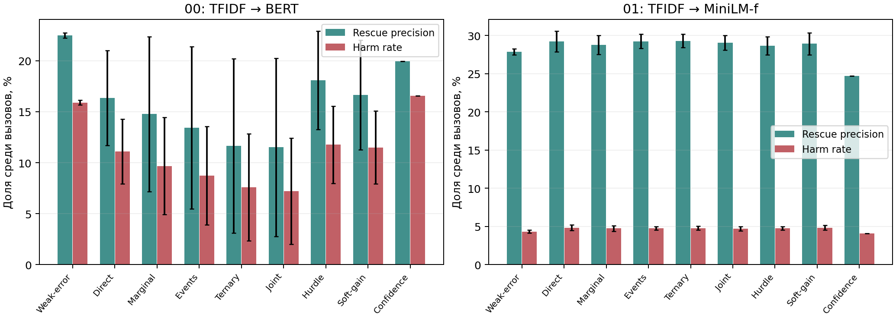
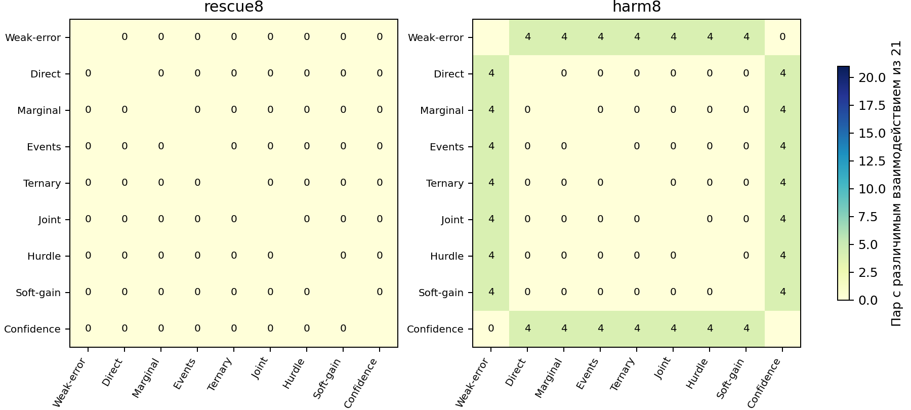

# Полная проверка выбора маршрутизатора при дисбалансе

Предыдущие сравнения сохраняются как промежуточные контроли. Выводы о полном наборе методов далее основаны на расширенной семье: 20 вместо 30 повторений, все восемь обучаемых методов вместо двух в контроле обогащения и девять вместо четырёх кандидатов selector. Значимость в прежней узкой семье не переносится автоматически на новый протокол и его общую поправку.

## От профиля решений к проверяемой гипотезе

Разные способы обучения могут иметь близкую accuracy, выбирая разные запросы. Если один метод одновременно чаще спасает ошибки и чаще портит правильные ответы, итоговая разность может компенсироваться. Это мотивирует гипотезу: изменение состава парной разметки способно неодинаково повлиять на методы и изменить их сравнительное качество. Она проверяется взаимодействием *метод $\times$ состав*, а не только эффектом коррекции одного оценивателя.

Используется полный набор восьми обучаемых способов из таблицы [полного набора методов](method.md#модели-и-критерии-обучения), confidence и случайное ранжирование. К четырём исходным экспертам относятся TF–IDF, BERT-tiny, frozen и fine-tuned MiniLM. Добавлены три ранее обученные TF–IDF-модели с 1/3/10 размеченными примерами каждого из 77 классов; их словарь фиксирован по исходной expert-train части. Проверены все 21 прежняя пара, а не выбранные по новому test-эффекту примеры. Эксперты не переобучаются. Направления low-label пар не всегда соответствуют росту стоимости; флаг порядка стоимости и полные параметры сохранены в `code/data/imbalance_manifest.json`.

## Факторная сетка и метрики

Fit содержит 200, 500 или 1 000 извлечений с возвращением; 20 seeds и квоты 10/20/40%. Семь составов — natural, rescue с множителем 2 или 8, harm с множителем 2 или 8, discordant с множителем 8 и neutral с множителем 8. Четыре сильных обогащения дополнительно проверены с IPW у всех восьми методов на тех же fit-строках. Всего получены 1 260 условий pair/seed/size и 110 880 выбранных роутеров после 443 520 кандидатов регуляризации. Признаки, сетка регуляризации, естественный tuning-dev размера $n/2$ и отдельный selector-dev500 общие. Для каждого варианта состава selector выбирает из восьми обучаемых методов и confidence.

Помимо accuracy и gain MSE измеряются precision, recall и F1 спасений, частота вредных замен, доля найденных вредных исходов и доля предотвращённого вреда. При $R$ спасениях, $H$ вредных заменах, $k$ вызовах и $N_+$ доступных спасениях:

$$
\begin{aligned}
\operatorname{precision}_{+}=\frac{R}{k},\qquad
\operatorname{recall}_{+}=\frac{R}{N_+},\qquad
F1_+=\frac{2R}{k+N_+},\qquad
\operatorname{harm\ rate}=\frac{H}{k}.
\end{aligned}
$$

При фиксированной паре и квоте три метрики спасений связаны одним числом $R$, поэтому не считаются независимыми подтверждениями. Accuracy определяется $R-H$, что допускает разные профили. Recall при отсутствии соответствующего события не определён, а не приравнен искусственно к нулю.

## Общая статистическая семья

Основная область — все 21 пары, fit1000, квота20%, official test. Проверены 5 691 контраст: 2 268 простых попарных accuracy-различий в natural/rescue8/harm8, 1 512 взаимодействий с составом, 1 512 различий natural-профилей, 336 IPW–raw и 63 selector–confidence. Использованы 2 000 crossed paired bootstrap повторов с точным пересчётом квоты и одной общей max-$|t|$ поправкой. Семья и сетка зафиксированы до запуска; меньшие объёмы, слабое обогащение, neutral/discordant, остальные квоты и clean-test сохраняются как описательные проверки устойчивости.

После общей поправки в natural обнаружено 0 из 756 попарных accuracy-различий (0 из 441 между семью gain-оценивателями). При этом в 0 сравнениях различим профиль спасений/вреда без обнаруженного accuracy-различия; это не доказательство эквивалентности accuracy.

Взаимодействие метода и состава поддержано в 56 из 1512 контрастов, в том числе в 0 из 882 между семью gain-оценивателями. Оно встречается в 4 из 21 пары (gain-only: 0). Эти пары зависимы и не являются независимыми задачами.

Поддержанных смен знака преимущества, при которых оба простых одновременных интервала лежат по разные стороны нуля, получено 0 (gain-only: 0). Значимое взаимодействие само по себе не требует смены победителя и не заменяет проверку простых эффектов.

Из 336 изменений отдельных методов от natural при rescue8/harm8 0 являются улучшениями и 28 — ухудшениями после той же общей поправки. Эти проверки уже входят в семью как взаимодействия с неизменным confidence.

| Метод      |   BERT Natural |   BERT Rescue8 |   BERT Harm8 |   MiniLM Natural |   MiniLM Rescue8 |   MiniLM Harm8 |
|:-----------|---------------:|---------------:|-------------:|-----------------:|-----------------:|---------------:|
| Weak-error |          87.87 |          87.89 |        87.67 |            91.26 |            91.3  |          91.25 |
| Direct     |          87.61 |          88.22 |        86.38 |            91.44 |            91.57 |          86.56 |
| Marginal   |          87.58 |          87.92 |        86.41 |            91.36 |            91.31 |          86.5  |
| Events     |          87.5  |          87.93 |        86.4  |            91.45 |            91.35 |          86.5  |
| Ternary    |          87.37 |          87.95 |        86.43 |            91.46 |            91.33 |          86.61 |
| Joint      |          87.42 |          87.93 |        86.43 |            91.43 |            91.32 |          86.61 |
| Hurdle     |          87.82 |          87.92 |        86.43 |            91.34 |            91.38 |          86.61 |
| Soft-gain  |          87.59 |          88.04 |        86.38 |            91.37 |            91.33 |          86.52 |
| Confidence |          87.24 |          87.24 |        87.24 |            90.68 |            90.68 |          90.68 |

Средняя accuracy, %, по 20 обучениям при fit1000 и квоте20% для двух исходных пар, полный набор девяти правил. Это иллюстративные средние; все SD, интервалы и остальные пары опубликованы отдельно.

Natural-профили всех правил на двух исходных парах: доли спасений и вреда среди эскалаций, средние и SD по 20 seeds. Нужно сравнивать оба компонента, а не только итоговую accuracy.

Число пар из 21 с различимым взаимодействием каждой пары методов и состава после общей поправки. Это зависимые конфигурации одного датасета; семь gain-методов отделяются от weak-error/confidence.

## Интерпретация и воспроизводимость

Гипотеза о чувствительности методов проверяется на фактических взаимодействиях. Для выбора метода важно дополнительно отличать изменение величины преимущества от надёжной смены предпочтительности, а улучшение от natural — от неодинакового ухудшения методов. Коррекция служит контролем механизма смещения обучающей цели, но не заменяет основную задачу выбора маршрутизатора.

Все модели, ID извлечений, weights и scores сохраняются локально; опубликованы полный per-seed результат, сводки, частоты выбора, regret и все статистические контрасты в `paper/imbalance_results/`. Запуск: `code/imbalance_study.py`, аудит: `code/audit_imbalance.py`, статистика: `code/imbalance_statistics.py`, отчёт: `code/analyze_imbalance.py`. Контроль повторно использует ранее изученный BANKING77 test. Он позволяет изучать чувствительность и локальный выбор, но не устанавливает переносимость рекомендации на независимые задачи.
