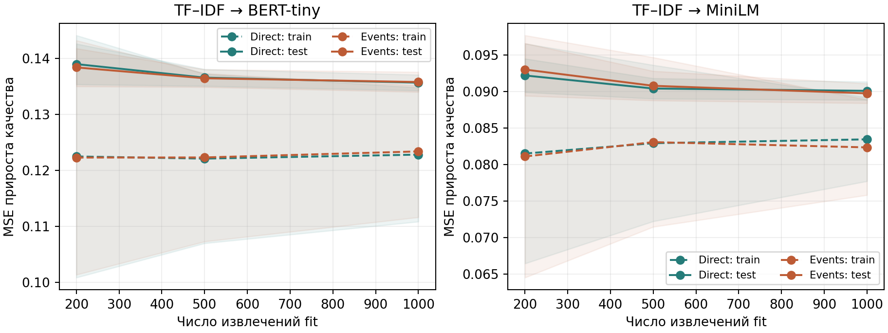
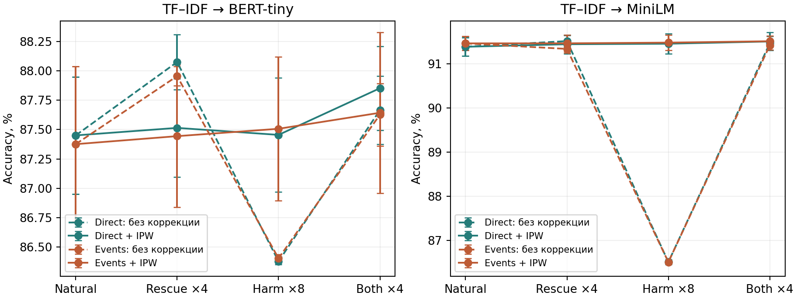
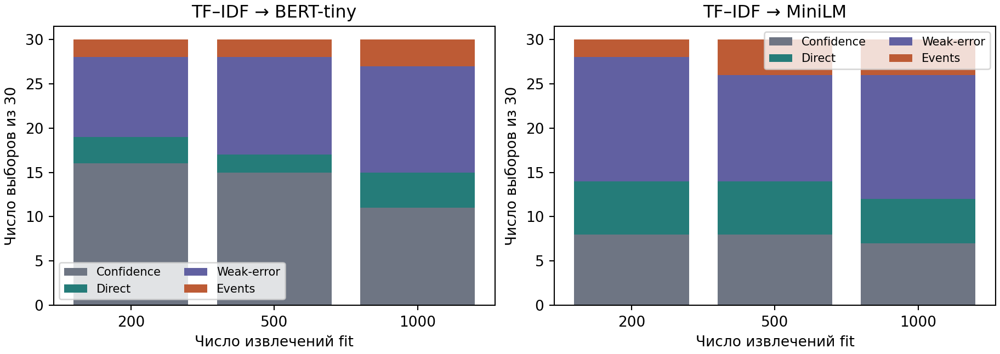

# Вычислительные эксперименты

## Цель и план анализа ошибки

Цель базового эксперимента — сравнить ошибку и профили решений маршрутизаторов при фиксированных экспертах, доступных признаках и одинаковой квоте эскалаций. Проверяется зависимость от количества парных примеров обучения и бюджета второго вызова. Прирост каскада над первой моделью, разница между правилами при одной квоте и обмен спасений на вред рассматриваются как разные результаты. Анализ состоит из трёх частей. Сначала сравниваются ошибка на fit и test, её среднее и SD при 200, 500 и 1 000 обучающих извлечениях. Затем при фиксированных признаках и паре изменяется состав данных; парное сравнение с весами и без проверяет роль смещения отбора. Наконец, отдельно оцениваются качество метода, выбранного на dev, и потеря относительно лучшего доступного test-кандидата. Внутренний критерий — MSE прироста, внешние — accuracy при квоте, числа спасений и вредных замен. Все разрезы и основная семья контрастов заданы в сохранённом протоколе до запуска нового контроля.

## Данные и разбиение

Используется BANKING77: англоязычные банковские обращения с 77 намерениями (Casanueva и др. 2020 г.). Источник — PolyAI revision `57ec275d8078af65b7731c2a98be812d844a6d6b`, лицензия CC BY 4.0. Из 10 003 train-строк удалены четыре нормализованных повтора; 9 999 строк стратифицированно разделены на expert-train 5 999, calibration 1 000, router-fit 2 000 и policy-dev 1 000. Нормализация для аудита — NFKC, нижний регистр и свёртка пробелов. Между train-частями текстовых пересечений нет. Official test 3 080 сохранён; дополнительная оценка без семи train/test пересечений и одного test-повтора содержит 3 072 строки. Manifest фиксирует исходные индексы, SHA и seeds разбиения 20260922, 20260923, 20260924. Часть calibration используется для аудита экспертов, не для настройки роутера.

## Фиксированные эксперты

В базовой конфигурации используются две пары: TF–IDF+LR с BERT-tiny и TF–IDF+LR с frozen MiniLM+LR. Все эксперты обучаются только на expert-train. Внутреннее разбиение 80/20 служит для выбора параметров, после чего выполняется refit на всех 5 999 строках.

TF–IDF использует word n-grams (1,2), min_df=2, sublinear TF и ограничение 30 000 признаков. LR настраивается по $C\in\{0.25,1,4,16\}$; выбран $C=16$. Frozen MiniLM — `sentence-transformers/all-MiniLM-L6-v2`, revision `1110a243fdf4706b3f48f1d95db1a4f5529b4d41`: нормализованный mean pooling и LR, $C\in\{0.25,1,4,16,64\}$, выбран $C=64$. BERT-tiny — `prajjwal1/bert-tiny`, revision `6f75de8b60a9f8a2fdf7b69cbd86d9e64bcb3837`; mean pooling и линейная классификационная голова. Во внутренней валидации выбраны восемь эпох; refit выполнен с AdamW, batch 32, encoder LR $10^{-4}$, head LR $10^{-3}$, weight decay 0.01, warmup/linear decay и gradient norm cap 1. Максимальная длина — 64 токена, seed обучения — 20261002.

Accuracy на official test: TF–IDF 86.56%, BERT-tiny 84.71%, frozen MiniLM 92.31%. Направления исходных пар заданы измеренной стоимостью вызова, а не точностью: более дорогой эксперт может быть хуже в среднем. Прогнозы экспертов зафиксированы до обучения роутеров.

## Признаки, методы и настройка

Восемь признаков: максимальная вероятность, top-two margin, нормированная энтропия, сумма квадратов вероятностей, вторая и третья вероятности и log1p длины запроса в символах/словах. Ответ и признаки второй модели недоступны при решении. Правильность и эталон используются как supervision и для оценки, не как входные признаки.

Сравниваются confidence (низкая максимальная вероятность), logistic weak-error, ridge direct на $D$ и две logistic rescue/harm-головы со score $\widehat p_+-\widehat p_-$. Weak-error вычитает из предсказанной ошибки первой модели среднюю train-ошибку второй; это proxy, а не точная условная сравнительная полезность. В каждом условии методы используют одинаковые fit/dev строки, признаки и tie-breaking keys. Классы функций и число параметров различаются; сравнение не является строго capacity-matched.

Объёмы fit — 200/500/1 000, dev=fit/2; 10 seeds подвыборок 0–9, квоты 10/20/40%. Подвыборки без возвращения вложены по размеру; scaler оценивается только на выбранном fit. L2-grid — $\{0.001,0.01,0.1,1\}$; выбор — по dev MSE, при точном равенстве выбирается более сильная регуляризация. Для ridge $\alpha=n\lambda$, для logistic $C=(n\lambda)^{-1}$; intercept не штрафуется. Train/dev/test роутера сохраняют естественное распределение. Бюджет данных включает настройку: 300/750/1 500 использованных пар.

Вычисляются accuracy, observed-$D$ MSE, числа спасений и вредных замен, таблица $Z_r$ и разброс по обучениям. Для каждого пакета выбираются ровно $\lfloor bN\rfloor$ запросов; при 20% это 616 вызовов из 3 080. Квота не является измеренной экономией денег или end-to-end latency. Базовая сетка содержит 60 условий и 180 финальных обучаемых роутеров; с четырьмя правилами, тремя квотами и двумя версиями test получается 1 440 строк метрик.

## Исходное сравнение без возвращения

| Способ     | Accuracy, % | SD, п.п. |
|:-----------|------------:|---------:|
| confidence |       90,68 |     0,00 |
| weak_error |       91,27 |     0,07 |
| direct     |       91,48 |     0,23 |
| events     |       91,53 |     0,17 |

TF–IDF $\to$ frozen MiniLM, fit 1 000/dev 500, 20% эскалаций. Средние и SD по 10 подвыборкам.

Ошибка каскада при изменении fit и dev=fit/2, TF–IDF $\to$ frozen MiniLM, 20% вызовов. Полосы — SD по 10 подвыборкам обучения.

Результаты представлены в таблице 1 и на рисунке 1. При увеличении обучения ошибка части правил снижается; SD по подвыборкам не является доверительным интервалом из независимых задач. При fit 1 000 direct и events имеют близкие средние accuracy, поэтому различия в сотых процента не рассматриваются как практическое преимущество.

На рисунке 2 показан описательный пример другой пары. Confidence исправляет в среднем 123 ответа и портит 102, Events — 85.2 и 51.1. Таким образом, меняется профиль решений: снижаются и спасения, и вредные замены. Пример выбран после просмотра пилота; отдельный статистический тест компонентов пока не проведён. Более широкий post-hoc анализ accuracy с общей поправкой на множественность не установил убедительного превосходства правил в проверенном режиме. Отсутствие значимости не означает практическую эквивалентность.

TF–IDF $\to$ BERT-tiny, fit 1 000/dev 500, 20% вызовов, средние counts по 10 обучениям. Строки — выигрыш выбранного действия относительно противоположного; колонки — эскалация да/нет.

## Контроль состава: новый протокол с возвращением

Для отделения смещения цели от особенностей прежнего отбора выполнен дополнительный эксперимент по алгоритму раздела [«Метод и теоретические основания»](method.md). Он использует тот же фиксированный пул 2 000 пар и ранее просмотренный test. Теперь fit формируется независимыми извлечениями с возвращением, так что вероятности и корректирующие веса известны точно. Это другой протокол, а не исправление прежних результатов обратными величинами эвристических весов отбора без возвращения.

В natural все строки равновероятны. В rescue-rich множитель равен 4 для спасений, в harm-rich — 8 для вреда, в discordant-rich — 4 для обоих ненейтральных исходов; остальные множители равны единице. Для каждого обогащения direct и events обучаются с IPW и без него на одних строках с общей стандартизацией. Natural дополнен weak-error и confidence. Входные признаки, эксперты и сетка регуляризации не меняются. Выбор регуляризации для всех условий происходит на естественном tuning-dev.

Для каждого из 30 seeds 0–29 одна перестановка policy-dev выделяет первые $n/2$ объектов для настройки, а позиции 500–999 — для отдельного selector-dev размера 500. При $n=200,500,1000$ настройка использует соответственно 100, 250 и 500 объектов; оставшиеся между tuning и selector не используются. Fit-извлечения вложены по объёму, общие случайные числа связывают составы. Selector выбирает только из четырёх natural-кандидатов для каждой квоты отдельно; enriched методы в этот выбор не входят. Test не участвует ни в одном из двух уровней выбора.

Получены 180 условий pair/seed/size и 2 700 выбранных обучаемых роутеров, каждый после проверки четырёх значений регуляризации. Сохранены модели, выбранные параметры, IDs с кратностями, scores, метрики fit/tuning/selector/test и результаты на clean test. Повторная загрузка всех 2 700 моделей воспроизвела test scores; 18 360 строк тестовых метрик независимо пересчитаны по решениям. Программа останавливается при предупреждении о несходимости.

## Кривые обучения и сравнение моделей

Natural sampling с возвращением. Пунктир — fit MSE, сплошные линии — test MSE; полосы показывают SD по 30 извлечениям. Для MiniLM рост fit уменьшает контрольную ошибку и разброс; для BERT-tiny улучшение слабее, остаточный разрыв сохраняется.

На рисунке 3 control MSE direct для MiniLM снижается примерно с 0,092 до 0,090, у events — с 0,093 до 0,090. Train/test разрыв сокращается, но не исчезает. Он включает как подгонку на fit, так и различия фиксированных пулов; это не чистая оценка смещения модели. Уменьшение MSE не обязательно приводит к тому же порядку методов по квотной accuracy. По трём объёмам нельзя устанавливать достаточный объём данных или гарантировать дальнейшее насыщение.

| Второй | Правило      |          Accuracy, % |                 MSE | Rescue |   Harm |
|:-------|:-------------|---------------------:|--------------------:|-------:|-------:|
| BERT   | Confidence   | $87{,}24\pm0{,}00$ |                   — | 123,00 | 102,00 |
| BERT   | Direct       | $87{,}45\pm0{,}50$ | $0.1357\pm0.0014$ |  93,20 |  65,73 |
| BERT   | Weak-error   | $87{,}87\pm0{,}08$ | $0.1378\pm0.0004$ | 138,57 |  98,13 |
| BERT   | Events       | $87{,}38\pm0{,}66$ | $0.1358\pm0.0018$ |  75,77 |  50,60 |
| BERT   | Dev-selector | $87{,}61\pm0{,}39$ |                   — | 121,20 |  88,73 |
| MiniLM | Confidence   | $90{,}68\pm0{,}00$ |                   — | 152,00 |  25,00 |
| MiniLM | Direct       | $91{,}39\pm0{,}20$ | $0.0901\pm0.0013$ | 179,27 |  30,60 |
| MiniLM | Weak-error   | $91{,}27\pm0{,}06$ | $0.0910\pm0.0006$ | 171,67 |  26,53 |
| MiniLM | Events       | $91{,}46\pm0{,}16$ | $0.0898\pm0.0014$ | 180,63 |  29,60 |
| MiniLM | Dev-selector | $91{,}16\pm0{,}28$ |                   — | 169,10 |  27,47 |

Natural, 1 000 извлечений, tuning 500, selector 500, 20% вызовов: средние accuracy и test MSE с SD по 30 seeds, средние числа спасений/вреда. Всего 3 080 запросов и 616 вызовов. MSE confidence и смешанного selector не интерпретируется как калибровка gain. Разные лидеры средних в двух парах мотивируют проверять процедуру выбора, а не назначать один метод универсально.

Для BERT-tiny weak-error имеет среднюю accuracy 87,87%, direct — 87,45%, events — 87,38%. Для MiniLM events даёт 91,46%, direct — 91,39%, weak-error — 91,27% (таблица 2). Это описательный порядок средних: отдельная семья всех попарных сравнений natural-методов в новом контроле не заявлялась. График accuracy при всех трёх объёмах опубликован вместе со сводными таблицами; исходный baseline без возвращения сохранён отдельно.

## Коррекция устраняет провал harm-rich обучения

1 000 извлечений, 20% вызовов. Пунктир — без коррекции, сплошные линии — IPW; полосы ошибок — SD по 30 seeds. В natural варианты совпадают. Провал harm-rich исчезает после взвешивания; для других обогащений эффект существенно меньше.

Наиболее выраженный результат — зависимость от коррекции в harm-rich (рисунок 4). Для MiniLM средняя accuracy direct меняется с 86,51% без коррекции на 91,45% с IPW; events — с 86,51% на 91,48%. Natural даёт соответственно 91,39% и 91,46%: коррекция восстанавливает уровень естественного обучения, но преимущество над natural этим не установлено. У BERT-tiny получены 86,38% и 87,45% для direct, 86,40% и 87,51% для events.

Механизм виден в профиле решений. У MiniLM harm-rich direct без коррекции в среднем спасает лишь 0,47 ответа при 2,07 вредных заменах; с IPW — 180,97 спасений и 30,17 вредных замен. Невзвешенное правило избегает областей возможного выигрыша, а равная квота всё равно требует 616 вызовов. Снижение числа вредных замен само по себе не означает лучший каскад: необходимо учитывать упущенные спасения. Искажение согласуется с формулой [изменения цели при отборе](method.md#почему-отбор-исходов-меняет-обучающую-цель); изменение функции потерь на тех же объектах является контролем этого объяснения, а не доказательством единственного механизма для произвольного класса моделей.

Цена обогащения также существенна. При 1 000 natural-извлечениях в среднем наблюдаются 790,8 уникальной строки; в harm-rich — 656,4 для BERT-tiny и 728,6 для MiniLM. Среднее число harm-извлечений возрастает соответственно с 78,0 до 406,0 и с 23,5 до 161,9. Для IPW эффективный размер по весам равен приблизительно 692 и 876. Разметка всего пула известна до отбора; улучшение не означает экономии приобретения меток. Для rescue-rich correction даже понижает некоторые средние; IPW исправляет целевой риск, но не обещает универсального улучшения квотного ранжирования.

## Неопределённость и чувствительность

Для основного режима (1 000 извлечений, official test, квота 20%) заранее выделены 14 сравнений: 12 corrected–uncorrected (две пары, три обогащения, два метода) и два selector–confidence. Использованы 2 000 crossed paired bootstrap повторов с общим перевыбором test-запросов и seeds обучения. При каждом повторе top-$k$ пересчитывается точно с учётом кратностей строк. Одна centered max-$|t|$ поправка задаёт одновременные 95% интервалы. Это приближённая процедура, условная на исходные пулы и экспертов; обученные scores и сделанный выбор по dev внутри каждого seed не переоптимизируются в bootstrap.

| Второй | Контраст            | $\Delta$, п.п. |    95% интервал | $p_{adj}$ |
|:-------|:--------------------|-----------------:|----------------:|------------:|
| BERT   | rescue / Direct     |            -0,56 | \[-1,29; 0,17\] |       0.262 |
| BERT   | rescue / Events     |            -0,51 | \[-1,47; 0,45\] |       0.732 |
| BERT   | harm / Direct       |             1,08 |  \[0,08; 2,07\] |       0.024 |
| BERT   | harm / Events       |             1,10 |  \[0,22; 1,99\] |       0.005 |
| BERT   | discordant / Direct |             0,19 | \[-0,35; 0,72\] |       0.971 |
| BERT   | discordant / Events |             0,02 | \[-0,57; 0,61\] |       1.000 |
| BERT   | Selector            |             0,37 | \[-0,10; 0,85\] |       0.236 |
| MiniLM | rescue / Direct     |            -0,07 | \[-0,34; 0,20\] |       0.999 |
| MiniLM | rescue / Events     |             0,13 | \[-0,19; 0,45\] |       0.941 |
| MiniLM | harm / Direct       |             4,95 |  \[3,75; 6,14\] |  $<0.001$ |
| MiniLM | harm / Events       |             4,97 |  \[3,77; 6,17\] |  $<0.001$ |
| MiniLM | discordant / Direct |             0,04 | \[-0,20; 0,28\] |       1.000 |
| MiniLM | discordant / Events |             0,09 | \[-0,10; 0,29\] |       0.828 |
| MiniLM | Selector            |             0,48 |  \[0,04; 0,91\] |       0.019 |

Полная семья 14 follow-up сравнений. Для rescue/harm/discordant контраст — IPW минус raw одного метода; для Selector — dev-выбор минус confidence. Все четыре harm-контраста положительны после общей поправки; для других обогащений ноль входит в интервалы.

Таблица 3 поддерживает прирост harm-rich для direct и events в обеих парах. В MiniLM он равен 4,95 и 4,97 п.п., в BERT-tiny — 1,08 и 1,10 п.п. Большой эффект относится к намеренному контролируемому сдвигу train и не является выигрышем нового роутера над сильным естественным baseline. Статистическая семья отличается от прежнего широкого анализа natural-методов; результаты не отменяют его выводов.

Дополнительно рассчитаны квоты 10/40%, все меньшие fit-объёмы и clean test 3 072. Они опубликованы как описательные разрезы и не включены постфактум в отдельную семью значимости. При 1 000 извлечениях знак harm-rich corrected–raw сохраняется для обоих методов во всех трёх квотах. На official test прирост лежит в пределах 0,96–1,10 п.п. для BERT-tiny и 2,95–5,90 п.п. для MiniLM. Переход к clean test меняет эти контрасты менее чем на 0,02 п.п.; это проверка чувствительности, не независимая репликация. Повторения используют общие пулы и одну панель экспертов; разброс по seeds не отражает вариацию между независимыми задачами. Сам follow-up спланирован после прежнего просмотра test, поэтому общая поправка не превращает его в независимое подтверждающее исследование.

## Выбор метода по отдельному dev

Частоты выбора natural-метода на 500 selector-dev объектах при квоте 20%, 30 повторений. Выбор меняется между разбиениями и не сводится к постоянному выбору лидера test-средних.

При 1 000 извлечениях selector даёт 87,61% для BERT-tiny и 91,16% для MiniLM. Прирост над confidence равен соответственно 0,37 п.п. с интервалом $[-0.10;0.85]$ и 0,48 п.п. с интервалом $[0.04;0.91]$ после общей поправки. Таким образом, выбор приносит различимый выигрыш в одной паре, но не является надёжной заменой всем фиксированным кандидатам.

В качестве диагностики для каждого seed вычислен максимум test accuracy среди тех же четырёх fitted candidates. Это недоступный при эксплуатации oracle, не способ выбора параметров. Средняя потеря selector относительно него равна 0,34 п.п. для BERT-tiny и 0,36 п.п. для MiniLM; максимальная потеря среди 30 повторений в обеих парах — 1,04 п.п. Показатель оптимистичен для oracle, поскольку максимум вычислен на самом test, но характеризует цену ошибочного выбора внутри конечного набора кандидатов. Даже при росте fit selector-dev остаётся равным 500, поэтому увеличение обучающей выборки не обязано уменьшать ошибку верхнего уровня выбора.

## Воспроизводимость

Исходники и данные: <https://github.com/Nastik05/Cost-sensitive-routing>. Команда `python3 code/run.py` заново обучает роутеры по фиксированному кэшу, проверяет 1 440 строк метрик против исходного прогона и генерирует рисунки/таблицу. Это повтор обучения роутеров, а не независимое переобучение экспертов или новый test. Параметры экспертов, source revisions и хеши сохранены в `code/data/manifest.json`. Вычисления и визуализация разделены; численные фрагменты текста строятся из результатов автоматически. Новый контроль запускается `python3 code/followup.py`, анализ без обучения — `python3 code/analyze_followup.py`. Протокол, seeds, хеши входов и версий кода сохраняются вместе с результатами. Таблицы и рисунки follow-up генерируются из сохранённых метрик; все 14 контрастов доступны в CSV. Тесты проверяют точную идентичность взвешенного риска пула, нормальные уравнения ridge, непересечение tuning/selector и пересчёт top-$k$ при кратных объектах.

# Литература

Casanueva, Iñigo, Tadas Temčinas, Daniela Gerz, Matthew Henderson, и Ivan Vulić. 2020 г. «Efficient Intent Detection with Dual Sentence Encoders». В *Proceedings of the 2nd Workshop on Natural Language Processing for Conversational AI*, под редакцией Tsung-Hsien Wen, Asli Celikyilmaz, Zhou Yu, и др. Association for Computational Linguistics. <https://doi.org/10.18653/v1/2020.nlp4convai-1.5>.
