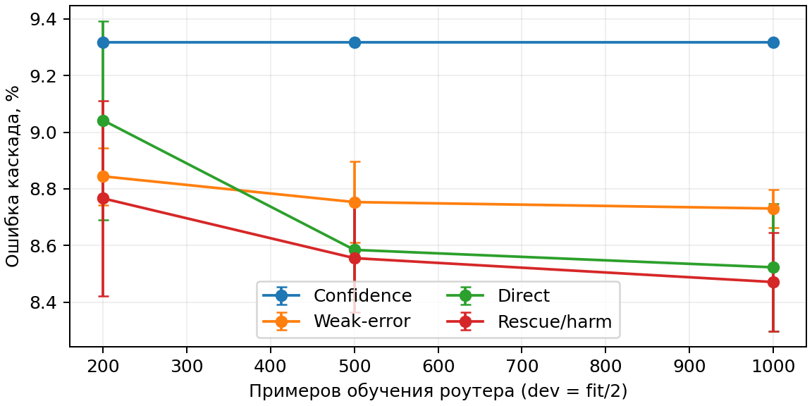
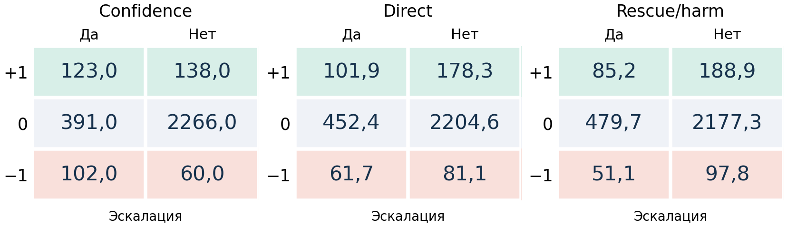

# Вычислительные эксперименты

## Цель и проверяемые свойства

Цель базового эксперимента — сравнить ошибку и профили решений маршрутизаторов при фиксированных экспертах, доступных признаках и одинаковой квоте эскалаций. Проверяется зависимость от количества парных примеров обучения и бюджета второго вызова. Прирост каскада над первой моделью, разница между правилами при одной квоте и обмен спасений на вред рассматриваются как разные результаты.

## Данные и разбиение

Используется BANKING77: англоязычные банковские обращения с 77 намерениями (Casanueva и др. 2020 г.). Источник — PolyAI revision `57ec275d8078af65b7731c2a98be812d844a6d6b`, лицензия CC BY 4.0. Из 10 003 train-строк удалены четыре нормализованных повтора; 9 999 строк стратифицированно разделены на expert-train 5 999, calibration 1 000, router-fit 2 000 и policy-dev 1 000. Нормализация для аудита — NFKC, нижний регистр и свёртка пробелов. Между train-частями текстовых пересечений нет. Official test 3 080 сохранён; дополнительная оценка без семи train/test пересечений и одного test-повтора содержит 3 072 строки. Manifest фиксирует исходные индексы, SHA и seeds разбиения 20260922, 20260923, 20260924. Часть calibration используется для аудита экспертов, не для настройки роутера.

## Фиксированные эксперты

В базовой конфигурации используются две пары: TF–IDF+LR с BERT-tiny и TF–IDF+LR с frozen MiniLM+LR. Все эксперты обучаются только на expert-train. Внутреннее разбиение 80/20 служит для выбора параметров, после чего выполняется refit на всех 5 999 строках.

TF–IDF использует word n-grams (1,2), min_df=2, sublinear TF и ограничение 30 000 признаков. LR настраивается по $C\in\{0.25,1,4,16\}$; выбран $C=16$. Frozen MiniLM — `sentence-transformers/all-MiniLM-L6-v2`, revision `1110a243fdf4706b3f48f1d95db1a4f5529b4d41`: нормализованный mean pooling и LR, $C\in\{0.25,1,4,16,64\}$, выбран $C=64$. BERT-tiny — `prajjwal1/bert-tiny`, revision `6f75de8b60a9f8a2fdf7b69cbd86d9e64bcb3837`; mean pooling и линейная классификационная голова. Во внутренней валидации выбраны восемь эпох; refit выполнен с AdamW, batch 32, encoder LR $10^{-4}$, head LR $10^{-3}$, weight decay 0.01, warmup/linear decay и gradient norm cap 1. Максимальная длина — 64 токена, seed обучения — 20261002.

Accuracy на official test: TF–IDF 86.56%, BERT-tiny 84.71%, frozen MiniLM 92.31%. Направления исходных пар заданы измеренной стоимостью вызова, а не точностью: более дорогой эксперт может быть хуже в среднем. Прогнозы экспертов зафиксированы до обучения роутеров.

## Признаки, методы и настройка

Восемь признаков: максимальная вероятность, top-two margin, нормированная энтропия, сумма квадратов вероятностей, вторая и третья вероятности и log1p длины запроса в символах/словах. Ответ и признаки второй модели недоступны при решении. Правильность и эталон используются как supervision и для оценки, не как входные признаки.

Сравниваются confidence (низкая максимальная вероятность), logistic weak-error, ridge direct на $D$ и две logistic rescue/harm-головы со score $\widehat p_+-\widehat p_-$. Weak-error вычитает из предсказанной ошибки первой модели среднюю train-ошибку второй; это proxy, а не точная условная сравнительная полезность. В каждом условии методы используют одинаковые fit/dev строки, признаки и tie-breaking keys. Классы функций и число параметров различаются; сравнение не является строго capacity-matched.

Объёмы fit — 200/500/1 000, dev=fit/2; 10 seeds подвыборок 0–9, квоты 10/20/40%. Подвыборки без возвращения вложены по размеру; scaler оценивается только на выбранном fit. L2-grid — $\{0.001,0.01,0.1,1\}$; выбор — по dev MSE, при точном равенстве выбирается более сильная регуляризация. Для ridge $\alpha=n\lambda$, для logistic $C=(n\lambda)^{-1}$; intercept не штрафуется. Train/dev/test роутера сохраняют естественное распределение. Бюджет данных включает настройку: 300/750/1 500 использованных пар.

Вычисляются accuracy, observed-$D$ MSE, числа спасений и вредных замен, таблица $Z_r$ и разброс по обучениям. Для каждого пакета выбираются ровно $\lfloor bN\rfloor$ запросов; при 20% это 616 вызовов из 3 080. Квота не является измеренной экономией денег или end-to-end latency. Базовая сетка содержит 60 условий и 180 финальных обучаемых роутеров; с четырьмя правилами, тремя квотами и двумя версиями test получается 1 440 строк метрик.

## Результаты

| Способ     | Accuracy, % | SD, п.п. |
|:-----------|------------:|---------:|
| confidence |       90,68 |     0,00 |
| weak_error |       91,27 |     0,07 |
| direct     |       91,48 |     0,23 |
| events     |       91,53 |     0,17 |

TF–IDF $\to$ frozen MiniLM, fit 1 000/dev 500, 20% эскалаций. Средние и SD по 10 подвыборкам.

Ошибка каскада при изменении fit и dev=fit/2, TF–IDF $\to$ frozen MiniLM, 20% вызовов. Полосы — SD по 10 подвыборкам обучения.

Результаты представлены в таблице 1 и на рисунке 1. При увеличении обучения ошибка части правил снижается; SD по подвыборкам не является доверительным интервалом из независимых задач. При fit 1 000 direct и events имеют близкие средние accuracy, поэтому различия в сотых процента не рассматриваются как практическое преимущество.

На рисунке 2 показан описательный пример другой пары. Confidence исправляет в среднем 123 ответа и портит 102, Events — 85.2 и 51.1. Таким образом, меняется профиль решений: снижаются и спасения, и вредные замены. Пример выбран после просмотра пилота; отдельный статистический тест компонентов пока не проведён. Более широкий post-hoc анализ accuracy с общей поправкой на множественность не установил убедительного превосходства правил в проверенном режиме. Отсутствие значимости не означает практическую эквивалентность.

TF–IDF $\to$ BERT-tiny, fit 1 000/dev 500, 20% вызовов, средние counts по 10 обучениям. Строки — выигрыш выбранного действия относительно противоположного; колонки — эскалация да/нет.

## Воспроизводимость

Исходники и данные: <https://github.com/Nastik05/Cost-sensitive-routing>. Команда `python3 code/run.py` заново обучает роутеры по фиксированному кэшу, проверяет 1 440 строк метрик против исходного прогона и генерирует рисунки/таблицу. Это повтор обучения роутеров, а не независимое переобучение экспертов или новый test. Параметры экспертов, source revisions и хеши сохранены в `code/data/manifest.json`. Вычисления и визуализация разделены; численные фрагменты текста строятся из результатов автоматически.

# Литература

Casanueva, Iñigo, Tadas Temčinas, Daniela Gerz, Matthew Henderson, и Ivan Vulić. 2020 г. «Efficient Intent Detection with Dual Sentence Encoders». В *Proceedings of the 2nd Workshop on Natural Language Processing for Conversational AI*, под редакцией Tsung-Hsien Wen, Asli Celikyilmaz, Zhou Yu, и др. Association for Computational Linguistics. <https://doi.org/10.18653/v1/2020.nlp4convai-1.5>.
