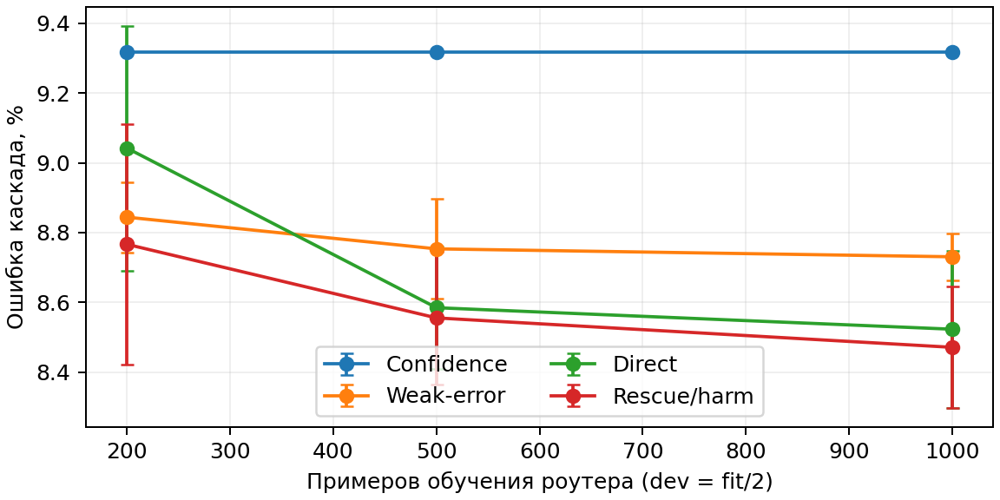
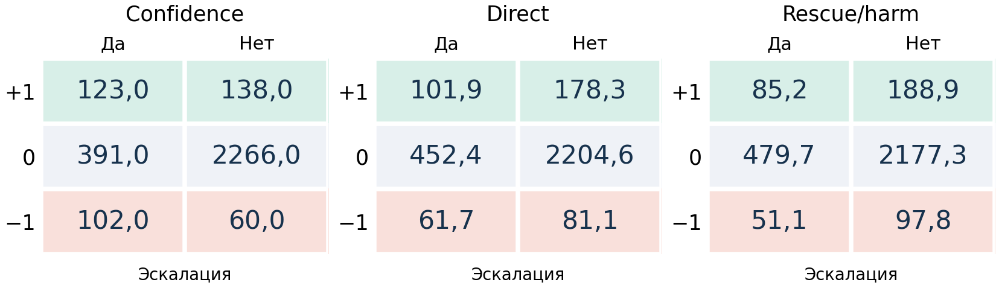
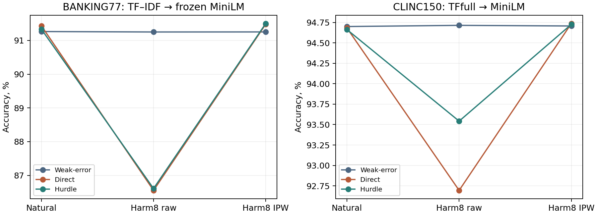
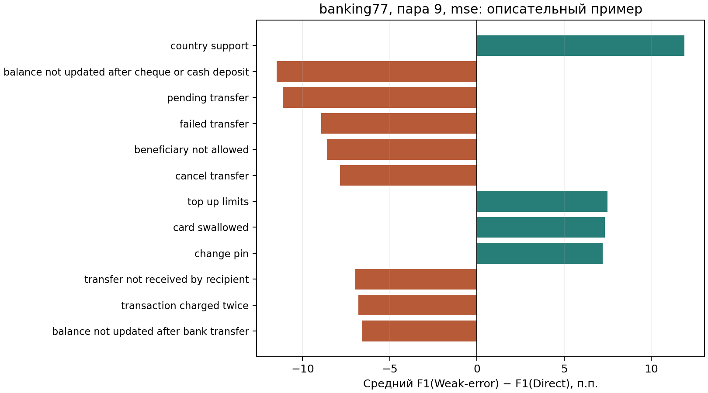

# Вычислительные эксперименты

## Цель и проверяемые свойства

Цель базового эксперимента — сравнить ошибку и профили решений маршрутизаторов при фиксированных экспертах, доступных признаках и одинаковой квоте эскалаций. Проверяется зависимость от количества парных примеров обучения и бюджета второго вызова. Прирост каскада над первой моделью, разница между правилами при одной квоте и обмен спасений на вред рассматриваются как разные результаты.

## Данные и разбиение

Используется BANKING77: англоязычные банковские обращения с 77 намерениями (Casanueva и др. 2020 г.). Источник — PolyAI revision `57ec275d8078af65b7731c2a98be812d844a6d6b`, лицензия CC BY 4.0. Из 10 003 train-строк удалены четыре нормализованных повтора; 9 999 строк стратифицированно разделены на expert-train 5 999, calibration 1 000, router-fit 2 000 и policy-dev 1 000. Нормализация для аудита — NFKC, нижний регистр и свёртка пробелов. Между train-частями текстовых пересечений нет. Official test 3 080 сохранён; дополнительная оценка без семи train/test пересечений и одного test-повтора содержит 3 072 строки. Manifest фиксирует исходные индексы, SHA и seeds разбиения 20260922, 20260923, 20260924. Часть calibration используется для аудита экспертов, не для настройки роутера.

## Фиксированные эксперты

В базовой конфигурации используются две пары: TF–IDF+LR с BERT-tiny и TF–IDF+LR с frozen MiniLM+LR. Все эксперты обучаются только на expert-train. Внутреннее разбиение 80/20 служит для выбора параметров, после чего выполняется refit на всех 5 999 строках.

TF–IDF использует word n-grams (1,2), min_df=2, sublinear TF и ограничение 30 000 признаков. LR настраивается по $C\in\{0.25,1,4,16\}$; выбран $C=16$. Frozen MiniLM — `sentence-transformers/all-MiniLM-L6-v2`, revision `1110a243fdf4706b3f48f1d95db1a4f5529b4d41`: нормализованный mean pooling и LR, $C\in\{0.25,1,4,16,64\}$, выбран $C=64$. BERT-tiny — `prajjwal1/bert-tiny`, revision `6f75de8b60a9f8a2fdf7b69cbd86d9e64bcb3837`; mean pooling и линейная классификационная голова. Во внутренней валидации выбраны восемь эпох; refit выполнен с AdamW, batch 32, encoder LR $10^{-4}$, head LR $10^{-3}$, weight decay 0.01, warmup/linear decay и gradient norm cap 1. Максимальная длина — 64 токена, seed обучения — 20261002.

Accuracy на official test: TF–IDF 86.56%, BERT-tiny 84.71%, frozen MiniLM 92.31%. Направления исходных пар заданы измеренной стоимостью вызова, а не точностью: более дорогой эксперт может быть хуже в среднем. Прогнозы экспертов зафиксированы до обучения роутеров.

## Признаки, методы и настройка

Восемь признаков: максимальная вероятность, top-two margin, нормированная энтропия, сумма квадратов вероятностей, вторая и третья вероятности и log1p длины запроса в символах/словах. Ответ и признаки второй модели недоступны при решении. Правильность и эталон используются как supervision и для оценки, не как входные признаки.

Сравниваются confidence (низкая максимальная вероятность), logistic weak-error, ridge direct на $D$ и две logistic rescue/harm-головы со score $\widehat p_+-\widehat p_-$. Weak-error вычитает из предсказанной ошибки первой модели среднюю train-ошибку второй; это proxy, а не точная условная сравнительная полезность. В каждом условии методы используют одинаковые fit/dev строки, признаки и tie-breaking keys. Классы функций и число параметров различаются; сравнение не является строго capacity-matched.

Объёмы fit — 200/500/1 000, dev=fit/2; 10 seeds подвыборок 0–9, квоты 10/20/40%. Подвыборки без возвращения вложены по размеру; scaler оценивается только на выбранном fit. L2-grid — $\{0.001,0.01,0.1,1\}$; выбор — по dev MSE, при точном равенстве выбирается более сильная регуляризация. Для ridge $\alpha=n\lambda$, для logistic $C=(n\lambda)^{-1}$; intercept не штрафуется. Train/dev/test роутера сохраняют естественное распределение. Бюджет данных включает настройку: 300/750/1 500 использованных пар.

Вычисляются accuracy, observed-$D$ MSE, числа спасений и вредных замен, таблица $Z_r$ и разброс по обучениям. Для каждого пакета выбираются ровно $\lfloor bN\rfloor$ запросов; при 20% это 616 вызовов из 3 080. Квота не является измеренной экономией денег или end-to-end latency. Базовая сетка содержит 60 условий и 180 финальных обучаемых роутеров; с четырьмя правилами, тремя квотами и двумя версиями test получается 1 440 строк метрик.

## Результаты

| Способ     | Accuracy, % | SD, п.п. |
|:-----------|------------:|---------:|
| confidence |       90,68 |     0,00 |
| weak_error |       91,27 |     0,07 |
| direct     |       91,48 |     0,23 |
| events     |       91,53 |     0,17 |

TF–IDF $\to$ frozen MiniLM, fit 1 000/dev 500, 20% эскалаций. Средние и SD по 10 подвыборкам.

Ошибка каскада при изменении fit и dev=fit/2, TF–IDF $\to$ frozen MiniLM, 20% вызовов. Полосы — SD по 10 подвыборкам обучения.

Результаты представлены в таблице 1 и на рисунке 1. При увеличении обучения ошибка части правил снижается; SD по подвыборкам не является доверительным интервалом из независимых задач. При fit 1 000 direct и events имеют близкие средние accuracy, поэтому различия в сотых процента не рассматриваются как практическое преимущество.

На рисунке 2 показан описательный пример другой пары. Confidence исправляет в среднем 123 ответа и портит 102, Events — 85.2 и 51.1. Таким образом, меняется профиль решений: снижаются и спасения, и вредные замены. Пример выбран после просмотра пилота; отдельный статистический тест компонентов пока не проведён. Более широкий post-hoc анализ accuracy с общей поправкой на множественность не установил убедительного превосходства правил в проверенном режиме. Отсутствие значимости не означает практическую эквивалентность.

TF–IDF $\to$ BERT-tiny, fit 1 000/dev 500, 20% вызовов, средние counts по 10 обучениям. Строки — выигрыш выбранного действия относительно противоположного; колонки — эскалация да/нет.

## Воспроизводимость

Исходники и данные: <https://github.com/Nastik05/Cost-sensitive-routing>. Команда `python3 code/run.py` заново обучает роутеры по фиксированному кэшу, проверяет 1 440 строк метрик против исходного прогона и генерирует рисунки/таблицу. Это повтор обучения роутеров, а не независимое переобучение экспертов или новый test. Параметры экспертов, source revisions и хеши сохранены в `code/data/manifest.json`. Вычисления и визуализация разделены; численные фрагменты текста строятся из результатов автоматически.

# Литература

Casanueva, Iñigo, Tadas Temčinas, Daniela Gerz, Matthew Henderson, и Ivan Vulić. 2020 г. «Efficient Intent Detection with Dual Sentence Encoders». В *Proceedings of the 2nd Workshop on Natural Language Processing for Conversational AI*, под редакцией Tsung-Hsien Wen, Asli Celikyilmaz, Zhou Yu, и др. Association for Computational Linguistics. <https://doi.org/10.18653/v1/2020.nlp4convai-1.5>.

<!-- expanded-experiments -->

# Расширенные эксперименты

# Экспериментальный протокол

## Две задачи и фиксированные панели экспертов

Используются BANKING77 (Casanueva и др. 2020 г.) и CLINC150 (Larson и др. 2019 г.). Первая задача содержит 77 банковских намерений, вторая — 150 намерений из десяти предметных областей; в CLINC рассматривается только in-scope классификация. Второй датасет введён после исследования BANKING77, по отдельному протоколу, зафиксированному до обучения новой панели и просмотра её test-результатов.

В BANKING77 после удаления четырёх нормализованных повторов 9 999 train-строк разбиты на expert-train 5 999, calibration 1 000, router-fit 2 000 и policy-dev 1 000. Эксперты — TF–IDF+LR, BERT-tiny, frozen MiniLM+LR, tuned MiniLM и три TF–IDF+LR с 1/3/10 размеченными примерами на класс. Используются все 21 фиксированная пара, включая три пары между low-label экспертами. Обучение экспертов отделено от обучения роутеров.

В CLINC150 официальный train разделён на expert-pool 10 500 и router-fit-pool 4 500, очищенный dev содержит 2 997 объектов. Четыре новых эксперта — TF–IDF+LR с 3 и 10 метками на класс, TF–IDF+LR на полном expert-pool и frozen MiniLM с новой LR-головой. Словарь low-label TF–IDF построен по текстам полного expert-pool; меняется доступ к меткам, а не к неразмеченным текстам. Из expert-pool 85% служат внутреннему обучению, 15% — выбору $C$, после чего выполняется refit; для low-label фиксировано $C=16$. Используется прежний pretrained snapshot MiniLM, но supervised-головы обучены на CLINC, без переноса BANKING77 голов. Проверены все шесть пар в порядке TF3, TF10, TFfull, MiniLM. Этот порядок задаёт сравнение панели; экономия фактической latency для low-label направлений отдельно не измерялась.

Official test сохранены: 3 080 запросов BANKING77 и 4 500 CLINC150. Дополнительные clean-test исключают обнаруженные нормализованные пересечения и повторы: 3 072 и 4 497 объектов соответственно. Для CLINC учитываются также точные текстовые совпадения с BANKING77. Объекты обучающих частей различны; сохранение official test допускает выявленные текстовые пересечения, поэтому clean-test служит отдельной проверкой чувствительности. Ревизии источников и параметры подготовки приведены в приложении.

## Общие кандидаты, составы и два критерия настройки

Для всех восьми методов из таблицы [\[tab:all_methods\]](#tab:all_methods) доступны одни восемь признаков первой модели: максимальная, вторая и третья вероятности, разность двух наибольших, нормированная энтропия, сумма квадратов вероятностей и log1p длины текста в символах и словах. Признаки и ответ второго эксперта при выборе недоступны. Стандартизатор оценивается только по fit.

Fit формируется извлечениями с возвращением; одинаковые случайные числа связывают сравниваемые условия. Natural означает равномерный отбор из router-fit-pool. В harm8 вероятность строки с $D=-1$ увеличивается множителем 8 относительно остальных исходов; *raw* и *IPW* используют одни извлечения и стандартизатор, но разные веса потери. Отбор выполняется по заранее известным парным исходам всего пула и не моделирует бесплатное приобретение меток.

BANKING77 проверяется по полной сетке: fit 200/500/1 000, 20 seeds, квоты 10/20/40%, семь составов natural/rescue2/rescue8/ harm2/harm8/discordant8/neutral8 и четыре сильных состава с IPW. Получены 110 880 выбранных роутеров после 443 520 кандидатов регуляризации. На CLINC150 используются fit 200/1 000, 20 seeds, те же квоты и natural/raw-harm8/IPW-harm8: 23 040 обученных кандидатов.

Общая сетка $\lambda\in\{0.001,0.01,0.1,1\}$ настраивается на естественном tuning-dev размера $n/2$. В BANKING77 используется MSE прогноза прироста. В CLINC150 одни и те же обученные кандидаты выбираются двумя способами: по MSE или по accuracy каскада при заданной квоте. Второй критерий выбирает $\lambda$ отдельно для каждой квоты; точные равенства разрешаются в пользу более сильной регуляризации. Это меняет критерий выбора, а не вычислительный бюджет обучения. Отдельные 500 dev-объектов используются selector для выбора из восьми методов и confidence. Test не входит в выбор.

## Контрасты и учёт неопределённости

Основной режим всех новых сравнений — fit1000, 20% вызовов, official test, средние по 20 обучениям. При этом требуется ровно 616 вторых вызовов в BANKING77 и 900 в CLINC150. Пусть $A_{s,m}$ — средняя accuracy метода $m$ при составе $s$. Различаются простой эффект в одном составе и взаимодействие:

$$
\begin{aligned}
\delta_{s;m,r}&=A_{s,m}-A_{s,r},\\
\Delta_{m,r}&=\delta_{\mathrm{harm8\ raw};m,r}
                 -\delta_{\mathrm{natural};m,r}.
\end{aligned}
$$

Положительное $\Delta$ означает улучшение *относительного* качества $m$ против $r$ при изменении состава. Оно может возникнуть, когда оба метода ухудшаются, но один теряет меньше. Отдельно проверяется эффект IPW минус raw одного метода на тех же данных.

| Код | Этап | Контрастов | Перевыборка и область |
|:---|:---|---:|:---|
| B | BANKING77 | 5 691 | 2 000 paired crossed повторов; простые эффекты, взаимодействия, профили, IPW, selector |
| C | CLINC150 | 1 698 | 2 000 повторов и одно уточнение до 10 000; оба tuning-критерия, простые эффекты и взаимодействия |
| M | Multiclass | 3 564 | 2 000 class-stratified paired crossed повторов; natural, три метрики, оба датасета |

Статистические семьи. Все интервалы в статье учитывают полную семью своего этапа; примеры не образуют новой уменьшенной поправки.

В каждой семье используются общие перевыборки seeds и test-запросов для сравниваемых методов, точный пересчёт top-$k$ с кратностями и одна centered max-$|t|$ поправка. Одновременные интервалы имеют номинальное покрытие 95%. Эксперты, обученные scores и сделанный выбор по dev условно фиксированы. Для C приведены интервалы уточнённого расчёта, а исходные интервалы и все шесть изменений граничного статуса сохранены; основные выделенные эффекты значимы в обоих расчётах. Уточнение Monte-Carlo точности не является повторным экспериментом на новых данных.

Семья M дополнительно сохраняет support каждого истинного класса при перевыборке запросов. Она оценивает accuracy, macro-precision и macro-F1 в natural; прочие условия многоклассового анализа рассматриваются описательно. Разные семейства имеют разные составы и процедуры перевыборки, поэтому их статусы значимости не используются как тест различия датасетов или tuning-критериев.

# Установленные улучшения и ухудшения

Таблица 2 объединяет конкретные эффекты, на которых основаны содержательные выводы. Для каждого эффекта сохранены исходный контраст, направление сравнения и полная семья. Это выбранные иллюстрации общей проверки, а не восемь независимых репликаций; полные подсчёты приведены в приложении.

| Сравнение / эффект                        | Семья |  П.п. |     95% интервал |
|:------------------------------------------|:-----:|------:|-----------------:|
| BANKING77: Direct–Weak-error, interaction |   B   | -4,87 | \[-7,34; -2,40\] |
| CLINC150: Direct–Weak-error, interaction  |   C   | -2,00 | \[-3,34; -0,66\] |
| CLINC150: Hurdle–Direct, harm8            |   C   |  0,85 |   \[0,03; 1,66\] |
| CLINC150: Hurdle–Direct, interaction      |   C   |  0,87 |   \[0,06; 1,68\] |
| CLINC150: Ternary–Direct, interaction     |   C   |  0,77 |   \[0,11; 1,43\] |
| CLINC150: Direct, IPW–raw                 |   C   |  2,04 |   \[0,68; 3,40\] |
| CLINC150: Ternary–Hurdle, accuracy        |   M   |  0,29 |   \[0,02; 0,57\] |
| CLINC150: Ternary–Hurdle, macro-F1        |   M   |  0,33 |   \[0,04; 0,63\] |

Основные подтверждённые эффекты при fit1000 и квоте 20%. Interaction означает изменение разности между natural и harm8 raw. Пары: B — TF–IDF → frozen MiniLM; C — TFfull → MiniLM, кроме Ternary–Direct (TF10 → TFfull); M — TF3 → MiniLM. В C используется accuracy-настройка, в B и M — MSE. Знак соответствует первому методу минус второй.

## BANKING77: отбор вызывает сравнительную деградацию gain-методов

В полном сравнении BANKING77 harm8 без коррекции ухудшает семь gain-параметризаций относительно обучаемого Weak-error на четырёх из 21 проверенной пары: TF–IDF → frozen MiniLM, TF–IDF → tuned MiniLM, BERT-tiny → frozen MiniLM и TF–IDF с 3 → 10 метками на класс. Получены 28 взаимодействий против Weak-error; ещё 28 относятся к тем же методам против неизменного confidence. Последний является контролем, поскольку не зависит от router-fit.

В примере TF–IDF → frozen MiniLM accuracy Direct меняется с 91,44% на 86,56%, а Weak-error — с 91,26% на 91,25%. Изменение Direct–Weak-error равно -4,87 п.п., одновременный интервал $[-7{,}34; -2{,}40]$. Таким образом, найден именно сдвиг сравнительного качества, а не только описательная разница двух средних. Аналогичные взаимодействия в этой паре установлены для остальных шести gain-методов. В семье B также подтверждены 28 ухудшений raw-обучения относительно natural через контрасты с фиксированным confidence и 34 положительных эффекта коррекции IPW относительно raw.

| Метод      | Natural, % | Harm8 raw, % | Harm8 IPW, % |
|:-----------|-----------:|-------------:|-------------:|
| Weak-error |      91,26 |        91,25 |        91,25 |
| Direct     |      91,44 |        86,56 |        91,49 |
| Marginal   |      91,36 |        86,50 |        91,51 |
| Events     |      91,45 |        86,50 |        91,52 |
| Ternary    |      91,46 |        86,61 |        91,53 |
| Joint      |      91,43 |        86,61 |        91,50 |
| Hurdle     |      91,34 |        86,61 |        91,50 |
| Soft-gain  |      91,37 |        86,52 |        91,49 |
| Confidence |      90,68 |        90,68 |        90,68 |

BANKING77, TF–IDF → frozen MiniLM: средняя accuracy в трёх составах, 20 обучений. IPW проверяется на тех же harm8-извлечениях. Числа в таблице описательные; статистические утверждения опираются на семью B.

## CLINC150: воспроизведение сравнительной деградации

На CLINC150 TFfull → MiniLM при MSE-настройке Direct меняется с 94,68% на 92,78%, Weak-error — с 94,71% на 94,74%. При настройке по квотной accuracy Direct меняется с 94,68% на 92,69%, Weak-error — с 94,70% на 94,71%. Для второго варианта изменение Direct–Weak-error равно -2,00 п.п., интервал $[-3{,}34; -0{,}66]$, скорректированное $p=0{,}0005$. Следовательно, обнаруженный тип сравнительной деградации воспроизводится в новой панели и сохраняется при эксплуатационном критерии настройки. Это проверка конкретного явления на втором датасете, а не усреднение независимых эффектов по всем парам.

| Метод      | Natural, % | Harm8 raw, % | Harm8 IPW, % |
|:-----------|-----------:|-------------:|-------------:|
| Weak-error |      94,70 |        94,71 |        94,71 |
| Direct     |      94,68 |        92,69 |        94,74 |
| Marginal   |      94,69 |        92,95 |        94,72 |
| Events     |      94,68 |        92,88 |        94,71 |
| Ternary    |      94,69 |        92,92 |        94,71 |
| Joint      |      94,68 |        92,94 |        94,71 |
| Hurdle     |      94,66 |        93,54 |        94,73 |
| Soft-gain  |      94,65 |        92,72 |        94,71 |
| Confidence |      94,47 |        94,47 |        94,47 |

CLINC150, TFfull → MiniLM: средняя accuracy, accuracy-настройка, fit1000, квота20%, 20 обучений.

## Внутри gain-семейства: Hurdle теряет меньше, чем Direct

**В harm8 raw Hurdle превосходит Direct на 0,85 п.п.** Для TFfull → MiniLM его accuracy составляет 93,54% против 92,69% у Direct. Простой одновременный интервал разности Hurdle–Direct равен $[0{,}03; 1{,}66]$, скорректированное $p=0{,}0351$. На natural средние составляют 94,66% и 94,68% соответственно. Отдельный тест взаимодействия даёт $\Delta_{\mathrm{Hurdle,Direct}}=0{,}87$ п.п., интервал $[0{,}06; 1{,}68]$, $p=0{,}0264$. Тем самым установлены одновременно выигрыш Hurdle в данном harm-режиме и изменение относительного качества между составами. Поскольку оба метода теряют относительно natural, интерпретация этого результата — *меньшая деградация Hurdle*.

Всего при accuracy-настройке подтверждены восемь из 126 gain-only взаимодействий на трёх парах: TF3 → TF10, TF10 → TFfull и TFfull → MiniLM. Все восемь сохраняются при увеличении числа bootstrap-повторов с 2 000 до 10 000; полный список дан в приложении. Например, для TF10 → TFfull изменение Ternary–Direct равно 0,77 п.п. с интервалом $[0{,}11; 1{,}43]$. Следовательно, неодинаковая чувствительность наблюдается не только между gain-целью и прогнозом ошибки первого эксперта, но и между реализованными параметризациями одной идеальной полезности.

Изменение средней accuracy при natural, harm8 raw и harm8 IPW. Слева — BANKING77, MSE-настройка; справа — CLINC150, accuracy-настройка. Линии показывают средние, без доверительных полос; неопределённость соответствующих контрастов приведена в таблице 2.

## Коррекция даёт измеримый прирост над raw-обучением

В той же паре CLINC150 IPW повышает accuracy Direct с 92,69% до 94,74%: эффект равен 2,04 п.п., интервал $[0{,}68; 3{,}40]$, $p=0{,}0005$. Raw и IPW используют одинаковые fit-строки, признаки, стандартизацию и сетку регуляризации; меняются веса обучающей потери, а регуляризация выбирается по одному и тому же правилу. Это контролируемое улучшение полного способа обучения с коррекцией.

Содержательный смысл состоит в восстановлении качества, утраченного при известном смещении: natural-среднее Direct равно 94,68%. Сравнение не следует представлять как выигрыш нового роутера над естественным обучением. Возвращение средних к исходному уровню и установленный IPW–raw эффект согласуются с изменением условной цели в формуле [\[eq:selection_shift\]](#eq:selection_shift). Поэтому при выборе по отобранной разметке нужны оба контроля: простой обучаемый Weak-error и корректно взвешенные gain-кандидаты.

# Качество конечного многоклассового ответа

## Преимущество Ternary на естественном составе

В отдельной общей семье M для CLINC150, TF3 → MiniLM, natural, fit1000, квота20%, MSE-настройка **Ternary превосходит Hurdle одновременно по accuracy и macro-F1**. Разница accuracy равна 0,29 п.п. с одновременным интервалом $[0{,}02; 0{,}57]$ и $p=0{,}0250$; разница macro-F1 — 0,33 п.п., интервал $[0{,}04; 0{,}63]$, $p=0{,}0130$. Это пример прямого выигрыша одного gain-метода над другим без искусственного изменения состава обучения.

| Метод      | Accuracy, % | Macro-P, % | Macro-F1, % |
|:-----------|------------:|-----------:|------------:|
| Weak-error |      71,387 |     73,083 |      70,962 |
| Direct     |      71,923 |     73,723 |      71,650 |
| Marginal   |      71,373 |     73,073 |      70,947 |
| Events     |      71,386 |     73,079 |      70,962 |
| Ternary    |      71,603 |     73,321 |      71,212 |
| Joint      |      71,577 |     73,275 |      71,176 |
| Hurdle     |      71,310 |     73,011 |      70,878 |
| Soft-gain  |      71,479 |     73,140 |      71,088 |
| Confidence |      71,911 |     73,812 |      71,788 |

CLINC150, TF3 → MiniLM, natural, MSE-настройка: многоклассовые метрики, средние по 20 обучениям. Статистически установлен контраст Ternary–Hurdle; таблица остальных кандидатов показывает полный контекст сравнения.

## Какая информация добавляется к accuracy

Метрики рассчитаны по истинным классам *итогового ответа каскада*. Восстановлены argmax-метки экспертов и решения маршрутизатора, сохранены исходные tie-breaking и выбранные dev-параметры. Всего пересчитаны 842 760 строк скалярных метрик всех сохранённых условий двух исследований. Для 42 079 уникальных основных политик классовые precision, recall и F1 независимо сверены со sklearn; accuracy, спасения, вред и число вызовов воспроизвели прежние результаты. На новых метриках роутеры не перенастраивались.

Для класса $c$ используются

$$
\begin{aligned}
P_c=\frac{TP_c}{TP_c+FP_c},\qquad
R_c=\frac{TP_c}{TP_c+FN_c},\qquad
F1_c=\frac{2TP_c}{2TP_c+FP_c+FN_c}.
\end{aligned}
$$

Нулевой знаменатель даёт 0; в усреднение входят все известные классы. Macro-F1 — среднее $F1_c$, а не гармоническое средних $P_c$ и $R_c$. В single-label классификации без отказа micro-P/R/F1 и weighted-recall совпадают с accuracy. Official test сбалансирован: 77 классов по 40 объектов в BANKING77 и 150 по 30 в CLINC150. Поэтому здесь дополнительно macro-recall совпадает с accuracy, а weighted-P/F1 — с macro-P/F1. Новая агрегированная информация содержится прежде всего в macro-precision и macro-F1.

Семья M включает все 36 попарных сравнений восьми обучаемых методов и confidence в 33 конфигурациях: 21 BANKING77 и шесть CLINC150 при двух критериях настройки. Три метрики дают 3 564 контраста; bootstrap сохраняет support каждого класса. Найденное преимущество Ternary относится к одному конкретному режиму и одной семье; accuracy и macro-F1 оцениваются на тех же ответах и не являются независимыми воспроизведениями.

## Разнонаправленные классовые эффекты при близких средних

Другой описательный пример — BANKING77, TF–IDF с одной меткой на класс → tuned MiniLM. На natural Weak-error и Direct имеют accuracy 42,742% и 42,766%, macro-precision 46,908% и 47,446%, macro-F1 42,660% и 42,827%. Разница accuracy в 0,024 п.п. соседствует с разницей macro-precision в 0,538 п.п. Это возможно, потому что замена одной неправильной метки другой меняет FP отдельных классов, сохраняя общую правильность.

Для класса `country_support` F1 Weak-error и Direct составляет 51,429% и 39,530%; для класса пополнения баланса после чека или наличного депозита — 40,910% и 52,389%. Направления различий противоположны. Рисунок 2 показывает перераспределение ошибок, скрытое близкой accuracy. Пример выбран после просмотра среди 348 сравнений с разницей средней accuracy не более 0,05 п.п., по максимальному абсолютному расхождению macro-F1. Классы также отсортированы после просмотра; при 40 объектах на класс это описательная диагностика, а не проверка устойчивой классовой специализации.

Описательный профиль Weak-error минус Direct, BANKING77, TF–IDF с одной меткой на класс → tuned MiniLM. Показаны 12 классов с наибольшим абсолютным расхождением среднего F1; классовые p-values не вычислялись.

# Обсуждение: условия выбора и границы результата

#### Что следует учитывать при выборе.

Проверенные эффекты поддерживают выбор по сочетанию трёх характеристик: механизма формирования парной разметки, реализованной параметризации полезности и эксплуатационной квоты. Сравнительная деградация gain-методов против Weak-error повторяется на втором датасете; внутри gain-семейства найдены конкретные преимущества и взаимодействия. Корректировка известного отбора даёт отдельный измеримый прирост, поэтому raw-победитель и победитель среди корректно обученных кандидатов отвечают на разные вопросы.

Практически это означает: сохранять простой обучаемый baseline, проверять попарные взаимодействия с механизмом отбора, сравнивать IPW и raw на одинаковых извлечениях и оценивать окончательный выбор на отдельном dev при нужной квоте. Полученные условия предпочтительности являются локальными ориентирами для такой процедуры, а не правилом всегда выбирать Weak-error, Hurdle или Ternary.

#### Как интерпретировать неподтверждённые сравнения.

Полная проверка сохраняет важные границы: в семье B natural-различия и gain-only взаимодействия не прошли поправку; в C не установлены прямое преимущество accuracy-настройки над MSE или надёжная смена знака преимущества между natural и harm8. В семье M найден один контраст методов по accuracy и macro-F1; случаев различимой macro-P/F1 при необнаруженной accuracy-разнице в той же семье нет. Эти результаты ограничивают область утверждений, но не отменяют конкретных эффектов таблицы 2. Незначимость не доказывает эквивалентности; разные статусы значимости не заменяют прямой тест различия эффектов.

#### Функциональный класс и критерий настройки.

Direct — линейный ridge-прогноз; Hurdle — произведение двух logistic-голов. Поэтому найденные различия относятся к полным реализованным способам обучения и могут включать вклад ёмкости, потерь и регуляризации. Accuracy-настройка меняет выбранную регуляризацию примерно в 38–48% случаев в рассмотренных основных срезах, но сама смена tuning-критерия не получила подтверждённого преимущества после общей поправки. Восемь gain-only взаимодействий относятся именно к заданному accuracy-tuned протоколу; их наличие не является доказательством превосходства этого критерия.

#### Обобщение и статистический статус.

BANKING77 повторно использовался после просмотра исходных результатов; CLINC150 добавлен по отдельному плану, но его multiclass-разбор выполнен уже после основных экспериментов. Выбранные иллюстрации не образуют новую подтверждающую выборку. Панели внутри датасетов зависимы, bootstrap условен на пулах, экспертах и обученных scores, а два intent-датасета не представляют всё разнообразие задач routing. Квота измеряет число вторых вызовов, не фактические денежные затраты или end-to-end latency. Отбор по парным исходам предполагает, что разметка полного пула уже приобретена.

#### Следующий содержательный контроль.

Для отделения обучающей цели от функционального класса нужен одинаковый Hurdle-подобный нелинейный score, обученный либо прямой MSE на приросте, либо факторизованными потерями, с одинаковыми признаками, регуляризацией и tuning-бюджетом. Затем критерий выбора по условной структуре ошибок и устойчивости границы квоты следует зафиксировать на development-данных и проверить на новой задаче. Этот контроль ещё не выполнялся; настоящие результаты задают его мотивацию и измеримые эффекты, которые требуется объяснить.

# Литература

Casanueva, Iñigo, Tadas Temčinas, Daniela Gerz, Matthew Henderson, и Ivan Vulić. 2020 г. «Efficient Intent Detection with Dual Sentence Encoders». В *Proceedings of the 2nd Workshop on Natural Language Processing for Conversational AI*, под редакцией Tsung-Hsien Wen, Asli Celikyilmaz, Zhou Yu, и др. Association for Computational Linguistics. <https://doi.org/10.18653/v1/2020.nlp4convai-1.5>.

Larson, Stefan, Anish Mahendran, Joseph J. Peper, и др. 2019 г. «An Evaluation Dataset for Intent Classification and Out-of-Scope Prediction». *Proceedings of the 2019 Conference on Empirical Methods in Natural Language Processing and the 9th International Joint Conference on Natural Language Processing (EMNLP-IJCNLP)*, 1311–16. <https://doi.org/10.18653/v1/D19-1131>.
